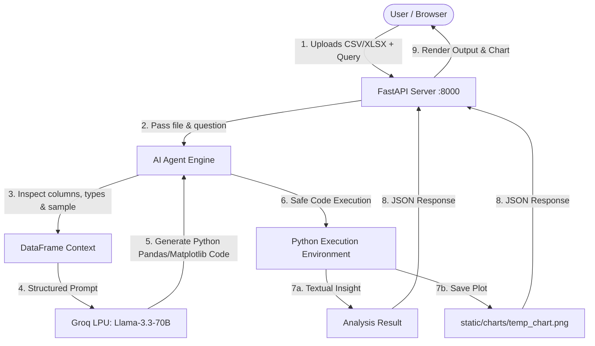

# 📊 AI Data Analysis Agent using LLMs

[](https://www.python.org/)
[](https://fastapi.tiangolo.com/)
[](https://groq.com/)
[](LICENSE)

An intelligent, full-stack **AI Data Analysis & Visualization Agent** that empowers users to query CSV and Excel datasets using natural language. Powered by **FastAPI** and **Groq's ultra-fast Llama-3.3-70B model**, the agent analyzes tabular data, writes and executes Python code dynamically, and automatically generates interactive charts and summaries.

---

## 🚀 Features

- **Natural Language Data Queries**: Ask arbitrary questions about your dataset without writing a single line of SQL or Python.
- **Automated Visualization**: Intelligently generates matplotlib charts (bar charts, line graphs, scatter plots, distributions) when asked or when visual analysis is needed.
- **Multi-Format Support**: Works seamlessly with both **CSV** (`.csv`) and **Excel** (`.xlsx`) files.
- **Ultra-Fast LLM Inference**: Leverages Groq's LPU inference engine with `llama-3.3-70b-versatile` for near-instant responses.
- **Interactive Modern UI**: Clean, responsive web frontend with file drag-and-drop, query history, live status indicators, and embedded chart viewing.
- **Robust REST API**: Built on **FastAPI** with CORS middleware, asynchronous file handling, and auto-generated Swagger documentation.

---

## 🏗️ Architecture & Workflow



---

## 📁 Project Structure

```text
├── app.py                     # FastAPI application & API endpoints
├── src/
│   ├── __init__.py
│   ├── agent.py               # Core LLM prompt generation & code execution engine
│   └── utils.py               # Utility functions & helpers
├── static/
│   ├── charts/                # Directory for dynamic chart outputs
│   ├── css/
│   │   └── style.css          # Frontend styling
│   └── js/
│       └── script.js          # Client-side form handling and AJAX
├── templates/
│   └── index.html             # Jinja2 web interface template
├── uploads/                   # Stored dataset files
│   └── test.csv               # Sample test dataset
├── .env.example               # Template for environment variables
├── requirements.txt           # Python package dependencies
├── setup.py                   # Package setup configuration
└── README.md                  # Project documentation
```

---

## 🛠️ Prerequisites

Ensure you have the following installed:
- **Python**: `3.10` or higher
- **Groq API Key**: Obtain a free API key from [Groq Console](https://console.groq.com/keys).

---

## ⚙️ Installation & Setup

### 1. Clone the Repository
```bash
git clone https://github.com/hammadrehmani/Building-a-Data-Analytics-Agent-using-LLMs.git
cd Building-a-Data-Analytics-Agent-using-LLMs
```

### 2. Create and Activate a Virtual Environment
- **Windows (PowerShell):**
  ```powershell
  python -m venv venv
  .\venv\Scripts\Activate.ps1
  ```
- **macOS / Linux:**
  ```bash
  python3 -m venv venv
  source venv/bin/activate
  ```

### 3. Install Dependencies
```bash
pip install -r requirements.txt
```

### 4. Configure Environment Variables
Create a `.env` file in the project root directory (or copy from `.env.example`):
```bash
cp .env.example .env
```
Open `.env` and add your Groq API key:
```env
GROQ_API_KEY="gsk_your_actual_groq_api_key"
```

---

## 🖥️ Running Locally

Start the development server with **Uvicorn**:

```bash
python -m uvicorn app:app --reload --host 127.0.0.1 --port 8000
```

Once running, open your web browser and navigate to:
- **Web Interface:** [http://127.0.0.1:8000](http://127.0.0.1:8000)
- **Interactive Swagger Docs:** [http://127.0.0.1:8000/docs](http://127.0.0.1:8000/docs)
- **Redoc Documentation:** [http://127.0.0.1:8000/redoc](http://127.0.0.1:8000/redoc)

---

## 💡 Example Queries

Upload a dataset (such as `uploads/test.csv`) and try asking:
- *"Show me the summary statistics of the dataset."*
- *"Which category has the highest sales? Plot a bar chart."*
- *"Find the correlation between age and income and plot a scatter plot."*
- *"Show the distribution of customer ratings."*

---

## 📡 API Endpoints

### `GET /`
Serves the web application user interface.

### `POST /analyze`
Analyzes an uploaded dataset based on a natural language prompt.
- **Parameters (Multipart Form-Data)**:
  - `file`: The `.csv` or `.xlsx` file.
  - `query`: String containing your question or instruction.
- **Response**:
  ```json
  {
    "answer": "Analysis result text...",
    "has_chart": true,
    "chart_url": "/static/charts/temp_chart.png"
  }
  ```

---

## 🛡️ License

This project is licensed under the [MIT License](LICENSE).

---

## 👤 Author

**Muhammad Hammad**  
- GitHub: [@hammadrehmani](https://github.com/hammadrehmani)
- Email: hammadrehmani1020@gmail.com
